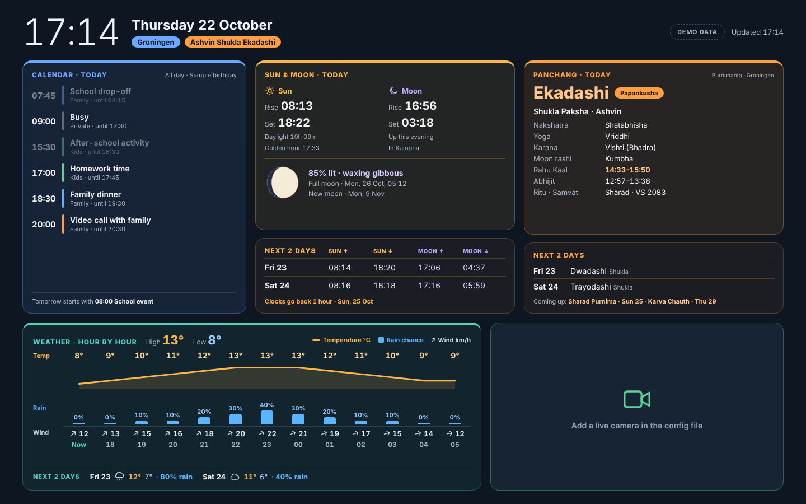

# Whatsup — family dashboard for the Mac

A calm, kid-friendly screen for the family MacBook. It runs as a **screensaver** or a **full-screen app** and shows:

- **Calendar** — today's family events (private events show as "Busy")
- **Sun & moon** — rise/set times, golden hour and tonight's moon drawn to its real phase
- **Panchang** — tithi, paksha, month, nakshatra, yoga, karana, Rahu Kaal, Abhijit, festivals
- **Weather** — hour by hour (temperature, rain chance, wind), today's high/low, next 2 days
- **India live camera** — streams you choose (e.g. Golden Temple, Amritsar)



## Two ways to run it

| | **Web app (recommended)** | **On one Mac only** |
|---|---|---|
| Open it on | any computer, tablet or phone; installable as an app | the Mac it's installed on |
| Sign-in | **Sign in with Google** — only accounts on your list | none needed (only that Mac can see it) |
| Calendar | read from your own Google account (read-only) | your Google Calendar's secret iCal address |
| Setup | in a browser: Cloudflare + Google, ~30 min | Terminal, ~15 min |
| Cost | free | free |

- **Web app:** follow **[docs/HOSTING.md](docs/HOSTING.md)**.
- **One Mac only** (also works as a macOS screensaver): carry on below.

---

## How the one-Mac version keeps things safe

- **Runs only on this Mac.** The dashboard is at `http://127.0.0.1:8765` and can't be reached from other devices.
- **No admin rights.** Everything installs into your user account. Nothing needs `sudo`.
- **Isolated.** Python packages go in the project's own `.venv` folder, pinned with hashes. Nothing is installed system-wide.
- **Private settings stay private.** The calendar's secret address lives in `~/Library/Application Support/whatsup/config.json` (readable by you only). It's never shown on the page, logged, or put in git.
- **Read-only.** The dashboard only reads your calendar. Nothing on the page can change settings.
- **Kid-safe camera.** Only the streams you add can play. They're muted and can't open other pages.
- **Offline-friendly.** Sun, moon and panchang are calculated on the Mac. Weather and calendar show the last good data if Wi-Fi drops.

> Tip: run it under a **standard (non-admin) macOS account** for the family.
> Remember the screen shows your family calendar to anyone in the room.

---

## Set it up on one Mac (first time, ~15 minutes)

You'll use the **Terminal** app (Applications → Utilities → Terminal). Copy each command, paste it, press Enter.

### 1. Install Apple's Command Line Tools

These give you Python and git.

```bash
xcode-select --install
```

Click **Install** in the window that appears. If it says they're already installed, carry on.

### 2. Get the project

Put it in `~/Apps`. **Not** Documents, Desktop or Downloads, because macOS blocks background apps there.

```bash
mkdir -p ~/Apps
git clone https://github.com/wackyclaude/whatsup.git ~/Apps/whatsup
```

If git asks you to sign in (private repo), use GitHub's **Code → Download ZIP** instead. Unzip it and move the folder to `~/Apps/whatsup`.

### 3. Install

```bash
~/Apps/whatsup/scripts/install.sh
```

This sets up Python, creates your private settings file, and starts the dashboard. It also starts it at every login.

When it says **Done**, open <http://127.0.0.1:8765> in Safari. You'll see sun, moon, panchang and weather straight away.

### 4. Add your family calendar

1. Open [Google Calendar](https://calendar.google.com) on the web. Click the **gear → Settings**.
2. On the left, under *Settings for my calendars*, click the **family calendar**.
3. Scroll to **Integrate calendar** and copy **Secret address in iCal format**.
4. In Terminal:

   ```bash
   ~/Apps/whatsup/scripts/configure.sh add-calendar
   ```

   Give it a name and colour, then paste the address. It stays hidden while you paste.

Repeat for each family calendar. **Never add a work calendar.**

> The secret address works like a password. If it ever leaks, go back to that same Google
> Calendar setting and click **Reset**. Then run `add-calendar` again with the new address.

### 5. Add India live cameras

1. On YouTube, open a live stream you trust, e.g. search *"Golden Temple live"* and pick the official channel.
2. Copy the link from the address bar.
3. In Terminal:

   ```bash
   ~/Apps/whatsup/scripts/configure.sh add-camera
   ```

Add as many as you like. In app mode you switch between them with buttons. As a screensaver, they rotate every 10 minutes.

### 6. Check everything

```bash
~/Apps/whatsup/scripts/check.sh
```

You should see today's event count and weather. It never prints your secret address.

---

## Set up the screensaver

This uses [WebViewScreenSaver](https://github.com/liquidx/webviewscreensaver), a free, open-source screensaver that shows a web page.

1. Download the latest **WebViewScreenSaver** zip from its [Releases page](https://github.com/liquidx/webviewscreensaver/releases). Unzip it.
2. Double-click **WebViewScreenSaver.saver**. Choose **Install for this user only** (no admin needed).
3. If macOS says it can't be opened: go to **System Settings → Privacy & Security**, scroll down and click **Open Anyway**.
   This keeps Apple's safety check on for everything else. Avoid install guides that turn it off.
4. **System Settings → Screen Saver** → pick **WebViewScreenSaver** → **Options…**
5. Add this address and set its time to **-1** (means "stay on this page"):

   ```
   http://127.0.0.1:8765/?mode=screensaver
   ```

6. Choose when it starts: **System Settings → Lock Screen → Start Screen Saver when inactive**.

In screensaver mode the mouse pointer and camera buttons are hidden.

## Use it as a full-screen app

```bash
~/Apps/whatsup/scripts/open-app.sh
```

This opens a clean full-screen window in Chrome, if installed. Otherwise it opens Safari; press **Control-Command-F** for full screen.

---

## Everyday

| To… | Run |
|---|---|
| See your settings (no secrets shown) | `scripts/configure.sh list` |
| Add / remove a calendar | `scripts/configure.sh add-calendar` / `remove-calendar` |
| Add / remove a camera | `scripts/configure.sh add-camera` / `remove-camera` |
| Change location | `scripts/configure.sh location` |
| Amanta vs Purnimanta months | `scripts/configure.sh panchang` |
| Test data sources | `scripts/check.sh` |
| Try it with sample data | `scripts/demo.sh` |
| Update to the latest version | `cd ~/Apps/whatsup && git pull && scripts/install.sh` |
| Stop and remove | `scripts/uninstall.sh` (add `--purge` to delete settings too) |

Festival dates are in `config/festivals.json`. They're checked against published 2026–27 calendars; add or edit lines as needed. Ekadashi names are worked out automatically.

## Troubleshooting

- **Page says "Waiting for the dashboard server"** — the service isn't running. Run `scripts/install.sh` again.
- **"Offline · showing data from…"** — the Mac couldn't reach Google or the weather service. It retries every few minutes by itself.
- **Calendar missing** — run `scripts/check.sh`. "HTTP 404" usually means the secret address was reset; add it again.
- **Screensaver shows a blank page** — open <http://127.0.0.1:8765> in Safari first to confirm the dashboard runs. Then re-check the address in the screensaver options.
- **Logs** — `tail -n 50 ~/Library/Logs/whatsup/dashboard.log`

## About the calculations

- **Sun & moon:** for your location, using [SunCalc](https://github.com/mourner/suncalc) and [Astronomy Engine](https://github.com/cosinekitty/astronomy). Both are bundled, so nothing loads from the internet.
- **Panchang:** taken at **local sunrise** in your location with the Lahiri ayanamsa. Rahu Kaal and Abhijit follow Groningen's sunrise and sunset, so they differ from Indian panchangs. Festival dates follow North Indian calendars.
- **Weather:** from [Open-Meteo](https://open-meteo.com). It's free and needs no account.

## For developers

```
cloud/                web app: Cloudflare Worker with Google sign-in (src/); tests: npm test, npm run test:runtime
static/               the page, shared by both versions (+ sign-in page, manifest, icons, service worker)
server/whatsup.py     local server: calendar + weather fetch, cache, JSON API (Python 3.9+, stdlib + 2 deps)
server/configure.py   guided settings changes
config/               example settings + festival list
scripts/              install, configure, check, demo, open-app, uninstall
tests/                python -m unittest discover tests  ·  TZ=Europe/Amsterdam node tests/test_sky.mjs
```

Dependencies are pinned with hashes in `requirements.txt` (generated from `requirements.in`).
